

  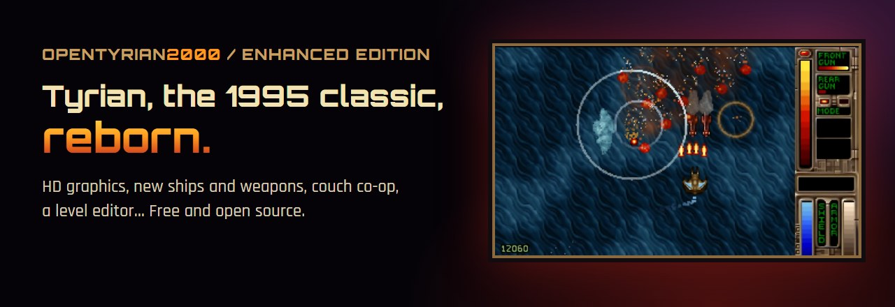

  <a href="README.md">English</a> · <a href="README.fr.md">Français</a> · <a href="README.es.md">Español</a> · <a href="README.de.md">Deutsch</a> · <a href="README.it.md">Italiano</a> · <a href="README.pt-BR.md">Português</a> · <b>Русский</b>

  <b>Tyrian 2000 на новом движке Godot 4 + Rust: вся кампания, Endless Arcade, кооператив на одном экране, пять пакетов модов и редактор уровней. Бесплатно и с открытым исходным кодом.</b>

  <a href="https://tyrian-enhanced.com/ru/"><b>🌐 tyrian-enhanced.com</b></a> ·
  <a href="#%EF%B8%8F-%D1%81%D0%BA%D0%B0%D1%87%D0%B0%D1%82%D1%8C"><b>⬇️ Скачать</b></a> ·
  <a href="#-%D0%BF%D0%B0%D0%BA%D0%B5%D1%82%D1%8B-%D0%BC%D0%BE%D0%B4%D0%BE%D0%B2-%D0%B8-%D0%BC%D0%BE%D0%B4%D0%B4%D0%B8%D0%BD%D0%B3">Моды</a> ·
  <a href="https://tyrian-enhanced.com/wiki/">Вики (на английском)</a> ·
  <a href="docs/PLAYER-GUIDE.md">Руководство игрока (на английском)</a>

  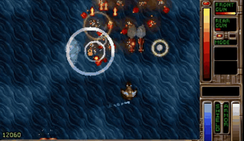 
  Настоящий геймплей на новом движке. 🔊 <b><a href="https://youtu.be/THaDU0-e4YY">Смотреть трейлер со звуком</a></b>.

## Что это такое?

Tyrian — культовый вертикальный скролл-шутер 1995 года от Eclipse Software: вы — **Trent Hawkins**, пилот истребителя, который в одиночку бросает вызов корпорации MicroSol. Впереди **пять эпизодов** безумных уворотов, запредельного оружия и уровней, набитых секретами.

**OpenTyrian2000 Enhanced Edition** запускает всю кампанию Tyrian 2000 на новом движке для **Windows, Linux и Steam Deck**. Играйте так, как вы её помните, или включите бесконечные волны Endless, кооператив на одном экране, мутаторы и моды, которые сделаете сами.

## ✨ Чего не было в Tyrian 2000

- ♾️ **Endless Arcade** (в меню — Endless Mode) — уровни, сшитые в волны нарастающей сложности, множители комбо, таблица 10 лучших результатов и мгновенный перезапуск, для одного или двух игроков.
- 👥 **Кооператив на одном экране** — двое игроков на двух геймпадах или за одной клавиатурой, в кампании и в режиме Endless.
- 🎲 **Мутаторы** — необязательные изменения правил, которые можно сочетать в любом забеге: *Bullet Hell*, *Glass Cannon*, *Mirror Mode* и другие.
- 🏆 **Достижения** — список открывается в игре клавишей F3, а о каждом новом достижении сразу появляется уведомление.
- 💥 **Эффекты попаданий** — от мощных ударов враги на миг замирают, боссы гибнут в цепочке взрывов, вылетают цветные цифры урона. Каждый эффект можно отключить.
- 🖼️ **HD-графика (ИИ), чёткий пиксель-арт и пять CRT-фильтров** — или оригинальные пиксели, на расстоянии одной клавиши.
- 🎵 **Улучшенный звуковой движок** — саундтрек General MIDI со своим SoundFont, а рядом оригинальная музыка AdLib.
- 🧩 **Система модов** — добавляйте оружие, корабли, сайдкики, щиты, врагов и встречи на уровнях из папки с файлами JSON и PNG, без перекомпиляции; игра тут же перезагружает ваш мод (5 пакетов модов-примеров в комплекте!).
- 🛠️ **Редактор уровней** — расставьте врагов, экспортируйте их в мод, соберите `.zip` и нажмите **Play from here** («играть отсюда»).
- 🎮 **Геймпад во всех меню**, с переназначением кнопок для обоих игроков и профилем Steam Deck при запуске из Steam.
- 🌍 **Поддержка нескольких языков** — английский, французский, испанский, немецкий, итальянский, португальский (русского перевода у игры пока нет).

| | | |
|---|---|---|
| 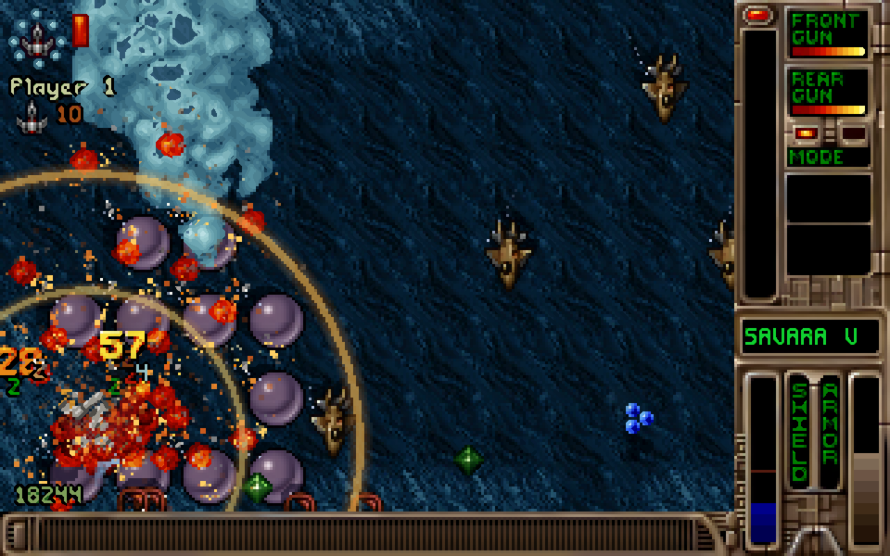 | 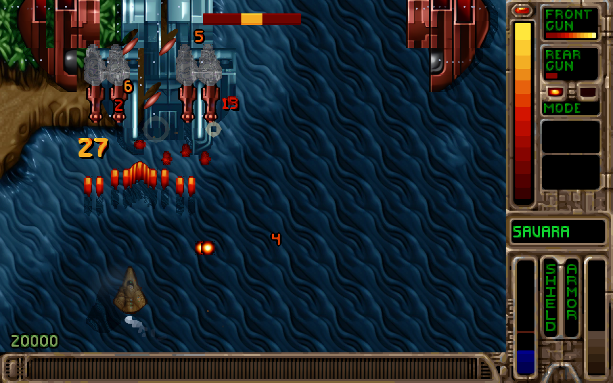 | 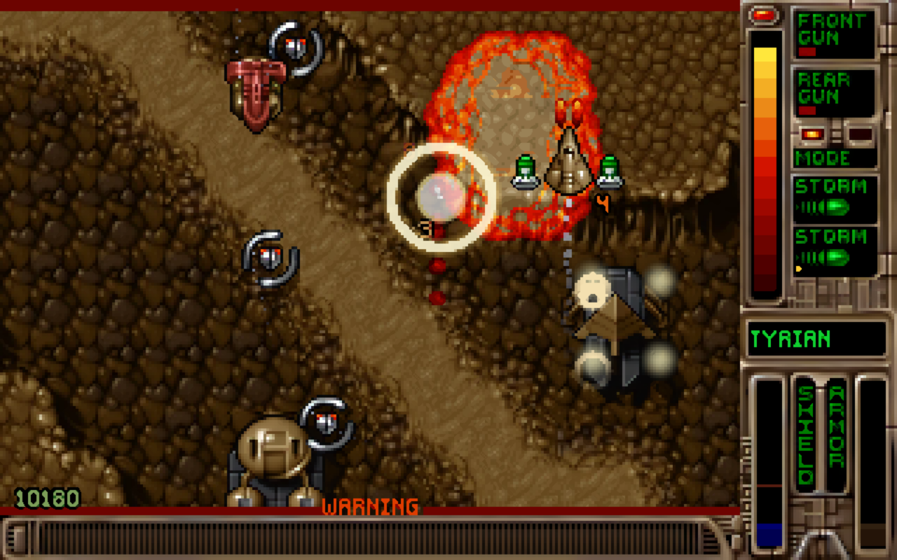 |
| 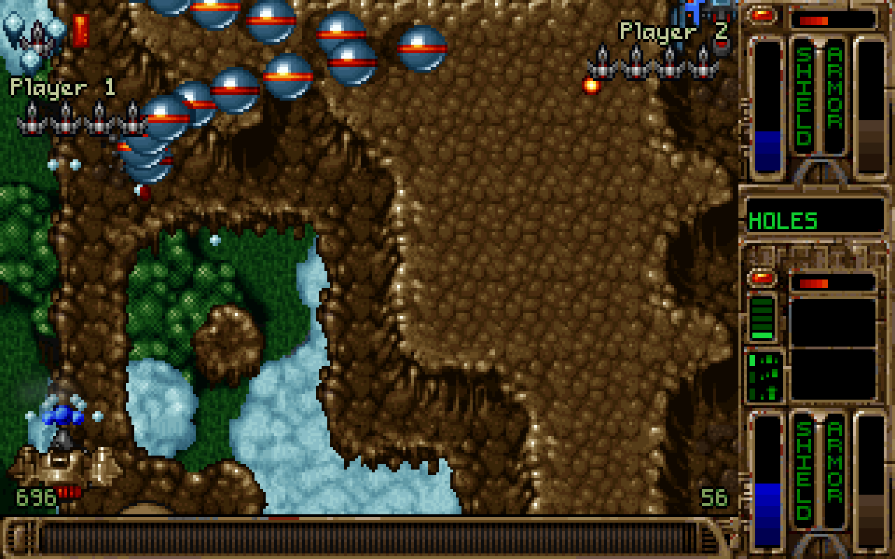 | 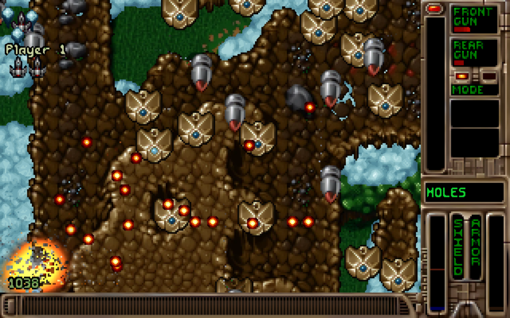 | 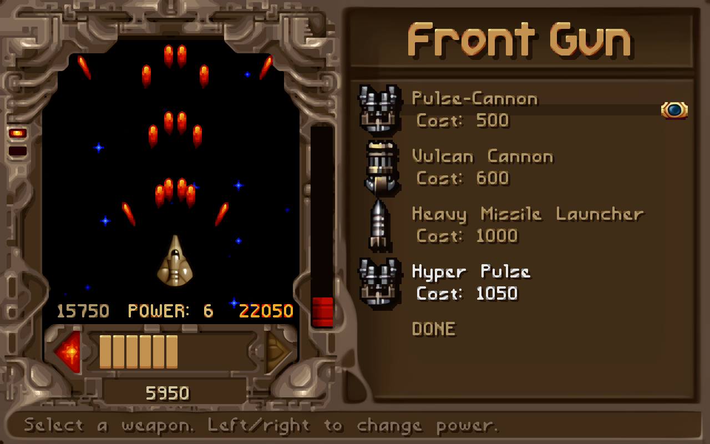 |

## 🧩 Пакеты модов и моддинг

С игрой поставляются пять пакетов; все они выключены, пока вы не включите их в **Setup → Mods**. Они нарисованы в стиле оригинального Tyrian, продаются во всех магазинах, сбалансированы относительно оригинальных предметов той же цены и могут работать все вместе.

| Пакет | Что добавляет |
|---|---|
| **Alien Ship Pack** | 8 кораблей двух инопланетных рас Tyrian, Hazudra и Zica, с анимацией крена |
| **Bio Ships Pack** | 6 биоорганических кораблей: панцири, перепончатые крылья и светящиеся споровые мешки |
| **Alien Weapon Pack** | 6 пушек Hazudra и Zica: термические копья, веер полумесяцев, самонаводящиеся дротики, плазменные кольца, навесной миномёт |
| **Bio Weapons Pack** | 6 живых зелёных пушек: споровые залпы, сгустки кислоты, пробивающие шипы, самонаводящиеся личинки |
| **Elements Weapon Pack** | 6 стихийных пушек: огонь, лёд, замораживающий врагов, молния, камень, кислота и ветер |

  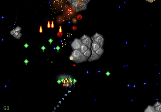 
  Zica Twin Furnace (Alien Ship Pack) с пушками из Alien Weapon Pack.

| | | | | |
|---|---|---|---|---|
| 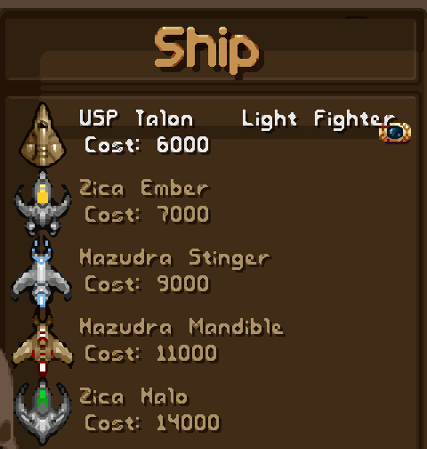 | 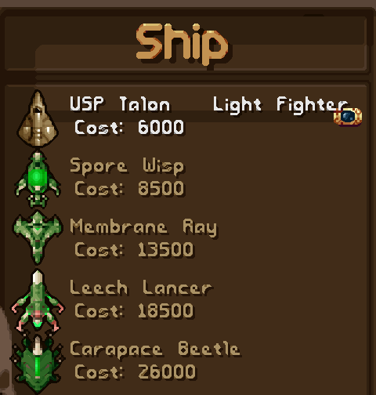 | 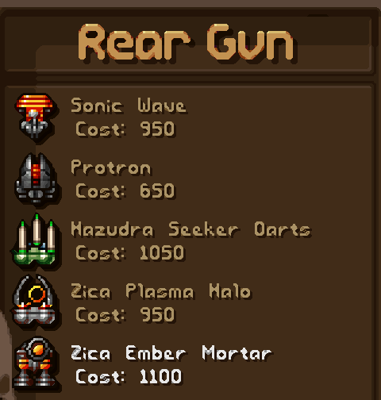 | 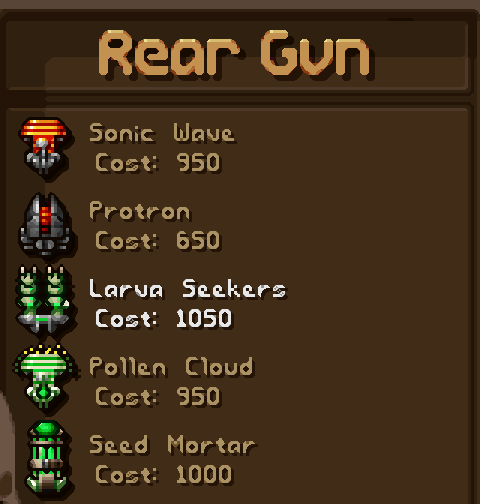 | 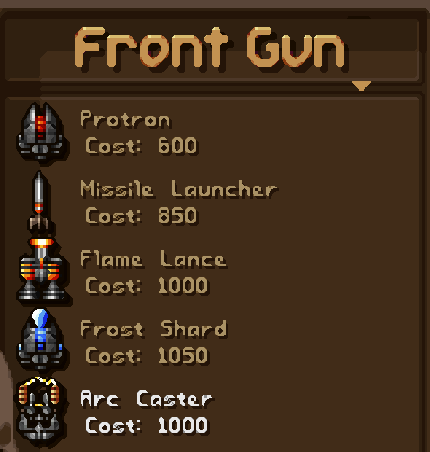 |

**Сделайте свой.** Мод — это просто папка: файл `mod.json` с описанием того, что вы добавляете, и, по желанию, спрайты PNG. Установите `.zip` через **Setup → Mods**, и игра тут же его подхватит.

- **Оружие, корабли, сайдкики, щиты и спецоружие** — продаются в магазине или выдаются в стартовом снаряжении.
- **Враги** — перебалансируйте любого оригинального врага или создайте новых, со своими траекториями полёта и турелями.
- **Встречи на уровнях** — добавляйте врагов на существующие уровни, указывая их по имени: никаких номеров ID.
- **Редактор уровней в Godot** — расставьте врагов, экспортируйте, упакуйте и нажмите **Play from here**. Начните с руководства **[Your first level in 15 minutes](docs/FIRST_LEVEL_15_MIN.md)** (на английском).
- **Безопасность по умолчанию** — сломанный мод показывает в меню понятную ошибку вместо того, чтобы обрушить игру, а JSON-схема даёт автодополнение в вашем редакторе.

Пока не поддаются моддингу: карты уровней (тайлы), музыка, звуковые эффекты и палитра. Полный справочник: **[MODDING.md](MODDING.md)** (на английском).

## ⬇️ Скачать

> **[v1.0-rc1](https://github.com/Patm4nzzz/opentyrian-enhanced/releases/tag/v1.0-rc1)**, первый выпуск, — это релиз-кандидат: всю игру можно пройти от начала до конца. Попробуйте и расскажите, что вы нашли ([примечания к выпуску](docs/release-notes-v1.0-rc1.md), на английском).

| Файл | Размер | |
|---|---:|---|
| `OpenTyrian2000-Enhanced-v1.0-rc1-windows-x86_64.zip` | 704,0 МБ | Windows, полный (с HD-графикой (ИИ)) |
| `OpenTyrian2000-Enhanced-v1.0-rc1-linux-x86_64.tar.gz` | 683,4 МБ | Linux / Steam Deck, полный |
| `OpenTyrian2000-Enhanced-v1.0-rc1-windows-x86_64-lite.zip` | 197,3 МБ | Windows, облегчённый (без HD-графики (ИИ)) |
| `OpenTyrian2000-Enhanced-v1.0-rc1-linux-x86_64-lite.tar.gz` | 185,6 МБ | Linux / Steam Deck, облегчённый |
| `OpenTyrian2000-Enhanced-v1.0-rc1-hd-pack.zip` | 506,5 МБ | HD-графика (ИИ) для облегчённой версии, обе системы |

- **Windows** — распакуйте `.zip`, откройте папку `OpenTyrian2000-Enhanced` и запустите `OpenTyrian2000-Enhanced.exe`. Если Windows покажет окно «Система Windows защитила ваш компьютер», нажмите **Подробнее → Выполнить в любом случае**; контрольные суммы SHA-256 всех архивов лежат в `SHA256SUMS.txt`.
- **Linux / Steam Deck** — распакуйте `.tar.gz` и запустите `./OpenTyrian2000-Enhanced.x86_64`. На Steam Deck добавьте игру в Steam как стороннюю, чтобы применился её профиль управления ([руководство для Steam Deck](https://tyrian-enhanced.com/ru/steam-deck/)).
- Каждый архив содержит данные игры, MIDI-саундтрек и пять пакетов модов; полные версии — ещё и HD-графику (ИИ). Не разбирайте папку: держите все файлы вместе.

Без установщика и без учётной записи. Известная проблема: сетевая игра недоступна (пункт «Modem/Network Game» неактивен).

## 🎮 Управление

| | Клавиатура | Геймпад |
|---|---|---|
| Движение | Стрелки | Левый стик / крестовина |
| Огонь | Пробел | A / RT |
| Режим задней пушки | Enter | B |
| Левый / правый сайдкик | Ctrl / Alt | X / Y |
| Пауза / продолжить | P или F2 | Start / RB |
| Внутриигровое меню | Esc | Back / LB |
| Справка в игре | F1 | — |
| Достижения / статистика (на уровне) | F3 / F4 | — |
| Быстрое сохранение / загрузка (кампания) | F5 / F9 | — |
| CRT-фильтр / графический режим (вне уровня) | F2 / F3 | — |

Клавиши меняются в Setup → Key Bindings. На титульном экране: **M** — дополнительные режимы и мутаторы, **2** — Endless для двух игроков, **DESTRUCT** — мини-игра. Всё остальное — в **[руководстве игрока](docs/PLAYER-GUIDE.md)** (на английском).

## 🛠️ Под капотом

- **Ядро на Rust** — игровая логика, форматы файлов и моды; **Godot 4** — рендеринг, ввод, звук и редактор.
- **Сверено с логикой оригинальной игры**: записанные забеги воспроизводятся такт в такт в строгих тестах, а автопилот проходит кампанию из пяти эпизодов от начала до конца.
- **Сборки проверяются в том виде, в каком их получают игроки**: в Linux-сборку играют под Xvfb с настоящим вводом, а экспортированный исполняемый файл Windows воспроизводит внутри себя записанный забег.
- Соберите сами: **[docs/build.md](docs/build.md)** · архитектура: **[docs/01-architecture.md](docs/01-architecture.md)** · тесты: **[docs/testing.md](docs/testing.md)** (на английском).

## 🙏 Авторы и лицензия

- **Tyrian** и **Tyrian 2000** © Eclipse Software, издатель — Epic MegaGames; с 2004 года данные игры распространяются бесплатно (freeware).
- Основано на **[OpenTyrian](https://github.com/opentyrian/opentyrian)** от The OpenTyrian Development Team, через его форк для Tyrian 2000 — OpenTyrian2000.
- **Enhanced Edition** — автор Patm4nzzz. Независимый проект сообщества, не связанный с Eclipse Software и Epic Games и не одобренный ими.

Код распространяется по лицензии GPL-2.0-or-later — см. [COPYING](COPYING). Данные Tyrian 2000, а также созданные на их основе графика, музыка и звуки — отдельные бесплатные ресурсы (freeware), на которые GPL не распространяется; см. `DATA-NOTICES.txt` в архиве.

Сайт: **[tyrian-enhanced.com](https://tyrian-enhanced.com/ru/)** · Вики (на английском): **[tyrian-enhanced.com/wiki](https://tyrian-enhanced.com/wiki/)** · Отзывы: [форма обратной связи](https://tyrian-enhanced.com/ru/contact/) или [задачи на GitHub](https://github.com/Patm4nzzz/opentyrian-enhanced/issues).
