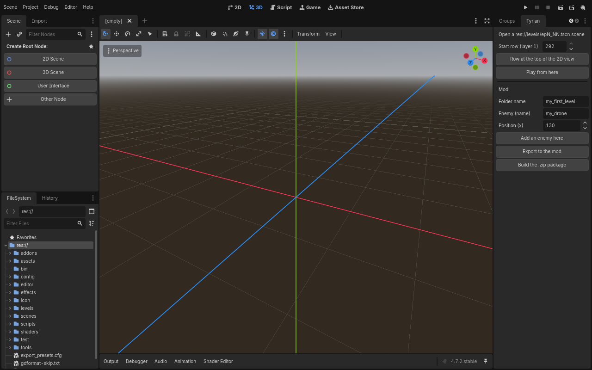
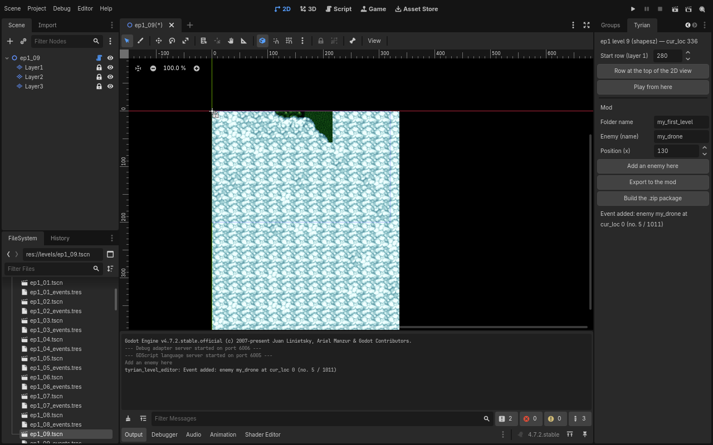
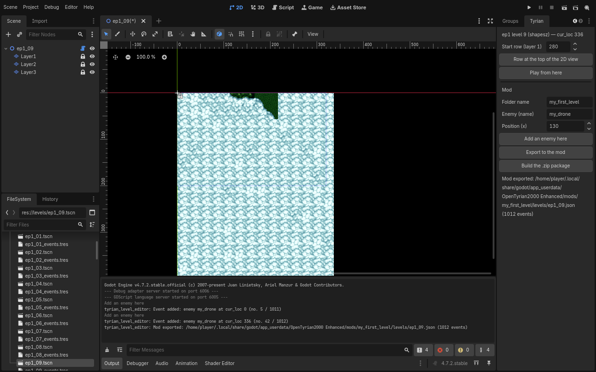
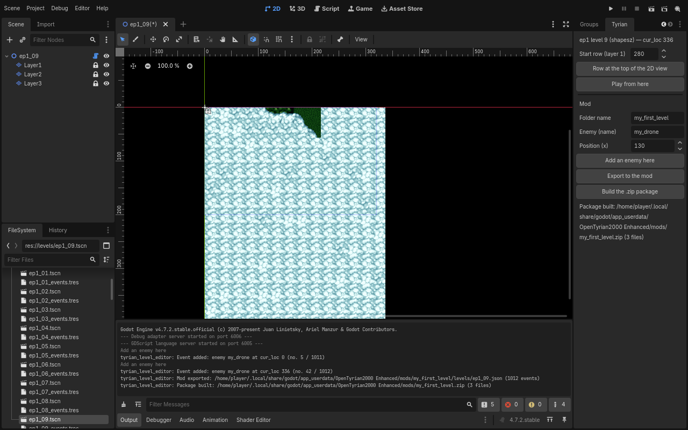
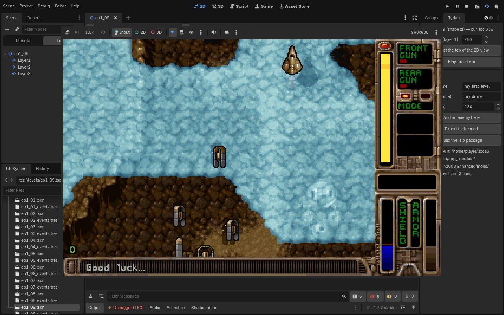
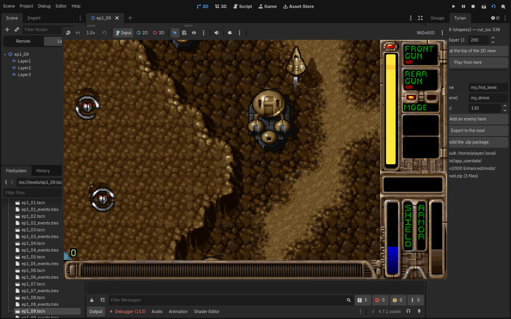
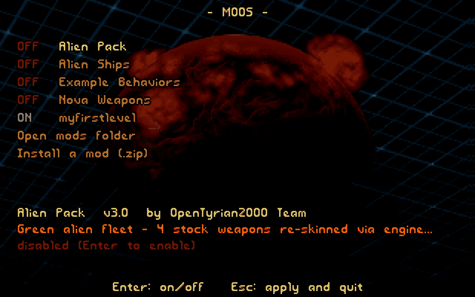
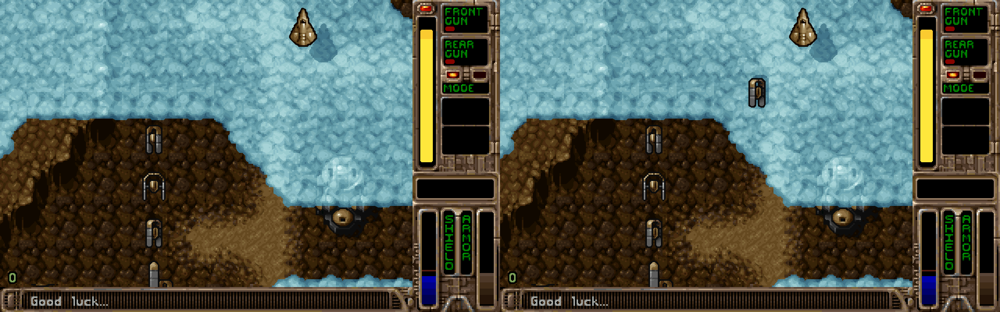

# Your first level in 15 minutes (Godot + Rust rewrite)

This tutorial replaces `FIRST_MOD.md` (branch `wip/sept-2026`, C version) for the rewrite.
It was actually followed end to end on 2026-10-04, and replayed on 2026-10-12 to refresh the
screenshots, with the Godot 4.7.2 editor running under Xvfb and driven by xdotool
(`rewrite/scripts/editor_session.sh`); every step has its screenshot in `docs/screenshots/mods/`.

Result: a mod `my_first_level` that adds a new enemy (`my_drone`, defined in data in the mod
template) to the first level of episode 1, played from the editor, then packaged as a `.zip`
ready to share. No Rust recompilation.

## 0. Set up (once)

```
cd rewrite
scripts/build-linux.sh          # GDExtension + resource import + 70 level scenes
godot -e --path godot           # opens the editor (the "Tyrian" plugin is already enabled)
```



The **Tyrian** dock (on the right) contains: the start row ("Start row (layer 1)"),
"Row at the top of the 2D view", "Play from here", then the **Mod** section ("Folder name",
"Enemy (name)", "Position (x)", "Add an enemy here", "Export to the mod",
"Build the .zip package").

## 1. Open a level (1 min)

In the *FileSystem* dock, double-click `res://levels/ep1_09.tscn` (first level of episode 1,
Tyrian). The 2D view shows the map; the Tyrian dock shows
`ep1 level 9 (…) — cur_loc …`. (In the recorded run the level was opened by double-clicking it,
then the main screen was switched to **2D**; `TYRIAN_EDITOR_OPEN=res://levels/ep1_09.tscn` opens
it at editor startup, see the end of this page.)

## 2. Add an enemy at the start of the level (2 min)

Leave the start row at its default value (bottom of the map, `cur_loc 0`), keep **Enemy (name)** =
`my_drone` and **Position (x)** = 130, then click **Add an enemy here**. The status line confirms:
`Event added: enemy my_drone at cur_loc 0 (no. … / …)`. The addition can be undone with
Ctrl+Z (Ctrl+Y redoes it). An unknown enemy name is refused in the dock, with the reason.


`my_drone` is a name: it refers to the new enemy declared in the `enemies` section of the
template (`rewrite/mod_template/mod.json`), with its movement defined in data (`behavior`). An
original enemy is also referenced by its name (e.g. `tech_corridor_32`; list:
`rewrite/mods/original-names.json`; preview sheets: `docs/original-enemies/`, generated by
`tyrian-mods catalog --sheets`, see MODDING.md §7.5). Everything a mod creates is referenced by
name; the engine assigns the slots (MODDING.md). The added event is a `spawn` ("enemy from the
sky", `level_events.c`, `docs/events-spec.md`); the export writes it as
`{ "time": 0, "spawn": "my_drone", "x": 130 }` (event types: MODDING.md §8).

## 3. A second enemy further on (2 min)

Set **Start row (layer 1)** to 280 (or position the 2D view and click "Row at the top of the
2D view"), then **Add an enemy here**: `cur_loc 336`.




## 4. Export to the mod (1 min)

**Export to the mod** writes `user://mods/my_first_level/`: a copy of the template (`mod.json` in
the single format, `"format_version": 1`, and `README.md`) and `levels/ep1_09.json` (all the
events of the level, key `events`, which replaces the original list). Status: `Mod exported: …/levels/ep1_09.json (1012 events)`.
The export runs the same validation as the game: an invalid mod is refused with the reason and
the previous file is kept.



Check outside the editor (same validation code as the game):

```
cd rewrite
cargo run --release -p tyrian-mods -- check --data ../data --mods "<user://>/mods" --enable-all
#   my_first_level  enabled … new-enemies 1 levels 1
#   summary: 1 mod(s), 1 enabled, 0 error(s), 0 warning(s)
cargo run --release -p tyrian-mods -- run --data ../data --mods "<user://>/mods" --enable-all --level ep1_09 --ticks 700
#   enemy 900 ('my_drone', mod): 2 spawn(s)
```

(`<user://>` = `~/.local/share/godot/app_userdata/OpenTyrian2000 Enhanced` on Linux,
`%APPDATA%/Godot/app_userdata/OpenTyrian2000 Enhanced` on Windows. Inside the editor the
player's files always go to this Godot user folder; an exported game uses the `userdata/` folder
next to its executable instead, see `docs/PLAYER-GUIDE.md` §6.)

## 5. Build the package (1 min)

**Build the .zip package** produces `user://mods/my_first_level.zip`, containing the
`my_first_level/` folder, to be extracted into the player's `userdata/mods/` (or installed with
**Setup → Mods → Install a mod (.zip)**). Status: `Package built: … (N files)`. (The C version
does not read this format.)



## 6. Play from here (2 min)

Set the row you want again, then click **Play from here**: the editor first exports if events
have changed, then launches `scenes/level.tscn`, which starts the level at that `cur_loc`
(`Game.start_level_at`, ADR 0126; the level scene fast-forwards with
`TyrianSim.fast_forward_to`).




The game runs embedded in the editor's *Game* view (screenshots above); stop it (Stop button
at the top right of the editor) to return to the editor.

## 7. Enable / disable in the game

Menu **Setup → Mods** (like `setup_menu.c` in the C version): Enter toggles the selected mod,
Esc applies (mods are reloaded) and returns. The choice is kept in `mods.cfg` in the player's
folder; `mod.json` is never rewritten. The last two lines of the menu, **Open mods folder** and
**Install a mod (.zip)**, open the player's mods folder and install a package such as
`my_first_level.zip`.




Screenshot 10: same start (cur_loc 320) at tick 379, without the mod (left) and with
`my_first_level` (right): 18 versus 19 enemies; the added drone is the small grey enemy at the
center right.

## Going further

- A complete new weapon and enemy: `rewrite/mods/_retired/example_behaviors/` ("Helix Driver" weapon,
  named enemy weapon, `zigzag_drone` with movement path, pursuit and turret);
  screenshot `screenshots/mods/11-example-behaviors-zigzag-drone.png`.
- Field reference: `MODDING.md` (rewrite), ADRs 0080 to 0083.

## Replay this tutorial automatically (Xvfb)

```
cd rewrite
TYRIAN_EDITOR_OPEN=res://levels/ep1_09.tscn EDITOR_SETTLE=45 scripts/editor_session.sh start
scripts/editor_session.sh click 255 45       # ep1_09 tab (the main scene "title" may open after it)
scripts/editor_session.sh click 1172 298     # Add an enemy here
scripts/editor_session.sh click 1200 100; scripts/editor_session.sh key ctrl+a
scripts/editor_session.sh type 280; scripts/editor_session.sh key Return
scripts/editor_session.sh click 1172 298     # second enemy
scripts/editor_session.sh click 1172 327     # Export to the mod
scripts/editor_session.sh click 1172 356     # Build the .zip package
scripts/editor_session.sh click 1172 156     # Play from here
scripts/editor_session.sh shot /tmp/x.png
scripts/editor_session.sh stop               # stops the game, the editor and Xvfb :88
```

Coordinates are valid for the default layout at 1280×800 and were measured on 2026-10-12
(other clicks used for the screenshots: FileSystem path field 110 457, `ep1_09.tscn` 84 780,
**2D** 507 16, *Output* tab 240 781). The script starts the editor without sound (unreachable
PulseAudio server): under WSLg the game launched by "Play from here" otherwise froze on its first
frame.
Pitfall: without a window manager, if a game window stays open, clicks no longer reach the
editor; close it (`stop` or kill `scenes/level.tscn`) before continuing.
