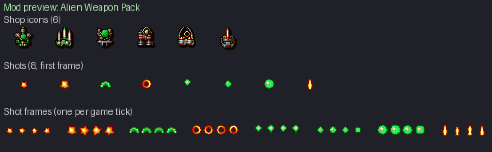

# Alien Weapon Pack

Six weapons of Tyrian's two alien races: the **Hazudra** (organic, reptilian:
bone and green) and the **Zica** (masters of heat and plasma: orange and red).
Three front guns, three rear guns, each with **eleven power levels** like the
original weapons (`front[]` / `rear[]`, MODDING.md §5.3).

Shop icons are 24x28 gun modules seen from above, in the look of the original
icons: grey metal housing, a coloured core, a near-black rim and the two-step
drop shadow. Shots are 12x14 sprites like the original ones (white-hot core,
saturated colour, dark rim), four animation frames each. Only colours of the
game palette are used. How they were made: `docs/mod-art-pipeline.md`.

Enable it in **Setup → Mods**. All six are sold in every shop.



| Weapon | Bay | Role | Price | Power use | What it does |
|---|---|---|---|---|---|
| Zica Thermal Lance | front | piercing | 1100 | 100 | White-hot lances that go through every enemy in their column (`{"pierce": n}`, 4 or 5 damage to each). 1 lance at level 1, 4 at level 11. |
| Hazudra Crescent Fan | front | spread | 1000 | 70 | A fan of green crescents, 2 wide at level 1, 7 wide at level 11. |
| Hazudra Spore Cannon | front | heavy | 1050 | 130 | Slow spore pods with the highest damage per hit of the pack (7 to 12, plus two small pods from level 8). For armoured targets; the most energy-hungry gun of the pack. |
| Hazudra Seeker Darts | rear | homing | 1050 | 80 | Darts that steer towards the nearest enemy (`homing` 9, then 8 from level 5, 7 from level 9: they turn more often). 1 dart at level 1, 5 at level 11. |
| Zica Plasma Halo | rear | area (flanks) | 950 | 50 | Spinning plasma rings fired to both sides, then also behind and on the four diagonals (2 rings at level 1, 8 at level 11). |
| Zica Ember Mortar | rear | area (lobbed) | 1100 | 90 | Ember shells thrown upward that slow down (`accel_y` -1), stop and fall back across the screen: they hit what is ahead, then what is behind the ship. 1 shell at level 1, 5 at level 11. |

## Balance

Damage per second (DPS) = damage of one volley × 35 / (fire_delay + 1), the
game running at 35 ticks per second. A piercing shot is counted once (single
target); a spread counts every projectile (what a wide target takes).
Energy per second = power use × 35 / (fire_delay + 1): the power use is paid at
every volley (wiki, *Weapons* and *Generators* pages). The originals compared
are the direct-fire guns sold at 900 to 1100 credits, read from the game data
(`data/tyrian.hdt`). Tables generated by

```
python utils/mod_weapon_balance.py rewrite/mods/alien_weapon_pack/mod.json --median \
    --names "Lightning Cannon,Sonic Impulse,Hyper Pulse,HotDog Front,Zica Laser,Starburst,Scatter Wave,Sonic Wave,HotDog Rear,NortShip Spreader"
```

(add `--energy` for the energy tables).

### Damage per second

#### Front (DPS, single target)

| Weapon | Price | Power | L1 | L2 | L3 | L4 | L5 | L6 | L7 | L8 | L9 | L10 | L11 |
|---|---|---|---|---|---|---|---|---|---|---|---|---|---|
| Zica Thermal Lance | 1100 | 100 | 14.0 | 19.4 | 28.0 | 31.1 | 38.9 | 43.8 | 50.6 | 56.9 | 65.6 | 70.0 | 78.8 |
| Hazudra Crescent Fan | 1000 | 70 | 17.5 | 23.3 | 30.0 | 35.0 | 40.0 | 50.0 | 55.0 | 61.2 | 70.0 | 74.4 | 85.0 |
| Hazudra Spore Cannon | 1050 | 130 | 18.8 | 26.2 | 32.1 | 38.2 | 46.7 | 50.9 | 57.3 | 64.2 | 76.4 | 82.7 | 91.0 |
| *Lightning Cannon (original)* | 1000 | 70 | 17.5 | 23.3 | 40.8 | 52.5 | 46.7 | 70.0 | 58.3 | 81.7 | 81.7 | 70.0 | 140.0 |
| *Sonic Impulse (original)* | 1000 | 50 | 17.5 | 23.3 | 35.0 | 35.0 | 35.0 | 46.7 | 52.5 | 70.0 | 70.0 | 70.0 | 70.0 |
| *Hyper Pulse (original)* | 1050 | 50 | 11.7 | 17.5 | 23.3 | 26.2 | 35.0 | 46.7 | 43.8 | 52.5 | 56.0 | 63.0 | 78.8 |
| *Zica Laser (original)* | 1100 | 90 | 24.5 | 35.0 | 42.8 | 56.9 | 74.4 | 78.8 | 87.5 | 150.0 | 170.0 | 166.2 | 192.5 |
| *HotDog Front (original)* | 1100 | 40 | 17.5 | 23.3 | 28.0 | 35.0 | 42.0 | 52.5 | 56.0 | 58.3 | 70.0 | 70.0 | 80.0 |
| *median of the originals above* | | | 17.5 | 23.3 | 35.0 | 35.0 | 42.0 | 52.5 | 56.0 | 70.0 | 70.0 | 70.0 | 80.0 |

#### Rear (DPS, single target)

| Weapon | Price | Power | L1 | L2 | L3 | L4 | L5 | L6 | L7 | L8 | L9 | L10 | L11 |
|---|---|---|---|---|---|---|---|---|---|---|---|---|---|
| Hazudra Seeker Darts | 1050 | 80 | 13.5 | 20.0 | 26.9 | 29.2 | 37.5 | 43.8 | 53.8 | 58.3 | 67.3 | 72.9 | 79.5 |
| Zica Plasma Halo | 950 | 50 | 17.5 | 26.2 | 35.0 | 40.0 | 50.0 | 58.3 | 70.0 | 75.8 | 80.0 | 93.3 | 99.2 |
| Zica Ember Mortar | 1100 | 90 | 14.6 | 23.3 | 31.8 | 37.9 | 44.5 | 56.0 | 63.6 | 70.0 | 76.4 | 84.0 | 91.0 |
| *Starburst (original)* | 900 | 20 | 23.3 | 23.3 | 35.0 | 35.0 | 46.7 | 46.7 | 70.0 | 70.0 | 93.3 | 105.0 | 186.7 |
| *Scatter Wave (original)* | 900 | 40 | 14.0 | 21.0 | 23.3 | 23.3 | 35.0 | 40.8 | 52.5 | 64.2 | 70.0 | 70.0 | 81.7 |
| *Sonic Wave (original)* | 950 | 50 | 10.0 | 15.0 | 20.0 | 25.0 | 30.0 | 50.0 | 70.0 | 75.0 | 80.0 | 90.0 | 100.0 |
| *HotDog Rear (original)* | 1100 | 40 | 23.3 | 35.0 | 35.0 | 52.5 | 70.0 | 70.0 | 84.0 | 98.0 | 93.3 | 80.0 | 80.0 |
| *NortShip Spreader (original)* | 1100 | 40 | 17.5 | 26.2 | 35.0 | 52.5 | 70.0 | 70.0 | 87.5 | 105.0 | 157.5 | 17.5 | 26.2 |
| *median of the originals above* | | | 17.5 | 23.3 | 35.0 | 35.0 | 46.7 | 50.0 | 70.0 | 75.0 | 93.3 | 80.0 | 81.7 |

### Generator energy per second

#### Front (generator energy per second)

| Weapon | Price | Power | L1 | L2 | L3 | L4 | L5 | L6 | L7 | L8 | L9 | L10 | L11 |
|---|---|---|---|---|---|---|---|---|---|---|---|---|---|
| Zica Thermal Lance | 1100 | 100 | 350 | 389 | 350 | 389 | 389 | 438 | 389 | 438 | 438 | 389 | 438 |
| Hazudra Crescent Fan | 1000 | 70 | 306 | 272 | 350 | 306 | 350 | 350 | 350 | 306 | 350 | 306 | 350 |
| Hazudra Spore Cannon | 1050 | 130 | 350 | 379 | 379 | 414 | 379 | 414 | 414 | 379 | 414 | 414 | 455 |
| *Lightning Cannon (original)* | 1000 | 70 | 408 | 408 | 408 | 408 | 408 | 408 | 408 | 408 | 408 | 817 | 1225 |
| *Sonic Impulse (original)* | 1000 | 50 | 438 | 583 | 438 | 438 | 438 | 583 | 438 | 438 | 438 | 438 | 438 |
| *Hyper Pulse (original)* | 1050 | 50 | 583 | 438 | 583 | 438 | 583 | 583 | 438 | 438 | 350 | 350 | 438 |
| *Zica Laser (original)* | 1100 | 90 | 315 | 350 | 350 | 394 | 394 | 394 | 394 | 450 | 450 | 394 | 394 |
| *HotDog Front (original)* | 1100 | 40 | 350 | 467 | 280 | 350 | 280 | 350 | 280 | 233 | 233 | 200 | 200 |
| *median of the originals above* | | | 408 | 438 | 408 | 408 | 408 | 408 | 408 | 438 | 408 | 394 | 438 |

#### Rear (generator energy per second)

| Weapon | Price | Power | L1 | L2 | L3 | L4 | L5 | L6 | L7 | L8 | L9 | L10 | L11 |
|---|---|---|---|---|---|---|---|---|---|---|---|---|---|
| Hazudra Seeker Darts | 1050 | 80 | 215 | 200 | 215 | 233 | 200 | 233 | 215 | 233 | 215 | 233 | 255 |
| Zica Plasma Halo | 950 | 50 | 219 | 219 | 292 | 250 | 250 | 292 | 250 | 292 | 250 | 292 | 292 |
| Zica Ember Mortar | 1100 | 90 | 262 | 262 | 286 | 262 | 286 | 315 | 286 | 315 | 286 | 315 | 315 |
| *Starburst (original)* | 900 | 20 | 233 | 233 | 350 | 350 | 233 | 233 | 350 | 350 | 233 | 175 | 233 |
| *Scatter Wave (original)* | 900 | 40 | 280 | 280 | 233 | 233 | 233 | 233 | 233 | 233 | 233 | 233 | 233 |
| *Sonic Wave (original)* | 950 | 50 | 250 | 250 | 250 | 250 | 250 | 250 | 250 | 250 | 250 | 250 | 250 |
| *HotDog Rear (original)* | 1100 | 40 | 467 | 350 | 350 | 350 | 350 | 280 | 280 | 280 | 233 | 200 | 200 |
| *NortShip Spreader (original)* | 1100 | 40 | 350 | 350 | 350 | 350 | 350 | 350 | 350 | 350 | 350 | 350 | 350 |
| *median of the originals above* | | | 280 | 280 | 350 | 350 | 250 | 250 | 280 | 280 | 233 | 233 | 233 |

Reading the tables:

- At every level each weapon stays between the weakest and the strongest
  original of its price. The lance (piercing) and the darts (homing) stay up
  to 30 % under the median of the originals, since they hit several targets or
  seldom miss; the fan and the mortar stay within 20 % of the median. The spore
  cannon and the halo end 14 % and 21 % above the median at level 11, far under
  the Zica Laser (192) and the Starburst (187); the spore cannon pays for it
  with the highest energy use of the pack.
- Energy per second is on the scale of the originals: front guns 272 to 455
  (originals of the table: 200 to 1225), rear guns 200 to 315 (originals: 175
  to 467). A Standard MR-9 generator (350 per second) feeds any one of them at
  level 1; two guns at high power need an Advanced MR-12 (490) or better, as
  with the original guns.

## Sprites

| File | Use |
|---|---|
| `sprites/pickups/weapons/*_icon.png` | 24x28 shop icons (`icon_sprite`) |
| `sprites/shots/<name>_1.png` .. `_4.png` | 12x14 shot frames: `thermal_lance`, `hazudra_crescent`, `spore_pod`, `spore_pod_large`, `seeker_dart`, `plasma_ring`, `ember_shell`, `ember_shell_large` |

The engine numbers the PNGs of `sprites/shots/` in name order, so the four
frames of a shot get consecutive sprite slots: each power level cites frame
`_1` and sets `"animation": 3`, which cycles the four frames, one per tick.
Keep that naming pattern when replacing a shot.
