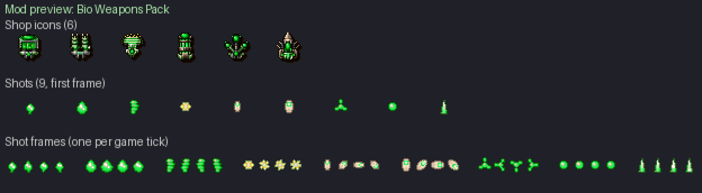

# Bio Weapons Pack

Six living weapons grown on gun housings: spores, acid, thorns, larvae, pollen
and seeds, all in glowing green. Three front guns, three rear guns, each with
**eleven power levels** like the original weapons (`front[]` / `rear[]`,
MODDING.md §5.3).

Shop icons are 24x28 gun modules seen from above, built from the original
Tyrian shop icons: the metal housing is kept, its coloured core becomes a
glowing green sac, plates turn into olive carapace or bone, and pods, thorns,
larvae and seeds grow over the metal; near-black rim and two-step drop shadow
as on the originals. Shots are 12x14 sprites (bright core, saturated body, dark
rim), four animation frames each. Only colours of the game palette are used.
Everything is drawn by `utils/bio_weapons_art.py` (see `docs/mod-art-pipeline.md`).

Enable it in **Setup → Mods**. All six are sold in every shop.



| Weapon | Bay | Role | Price | Power use | What it does |
|---|---|---|---|---|---|
| Spore Burst | front | spread | 1000 | 60 | One big spore and a ring of small ones fired from the same point with diverging paths: the volley leaves as a clump and opens into a cloud as it climbs. 3 spores at level 1, 8 at level 11. |
| Acid Spitter | front | heavy | 1100 | 140 | Acid globs spat slowly that speed up as they climb (`accel_y` 1), the highest damage per hit of the pack (7 to 14). One glob at level 1, two from level 5, a big one and two small ones from level 8. The most energy-hungry gun of the pack. |
| Thorn Needler | front | piercing | 1050 | 70 | Fast thorns that go through every enemy in their column (`{"pierce": n}`, 3 to 5 damage to each). 1 thorn at level 1, 4 at level 11. |
| Larva Seekers | rear | homing | 1050 | 80 | Larvae that crawl towards the nearest enemy (`homing` 9, then 8 from level 5, 7 from level 9: they turn more often). 1 larva at level 1, 5 at level 11. |
| Pollen Cloud | rear | area (short range) | 950 | 50 | Slow pollen puffs blown to both sides, then also behind, on the diagonals and ahead (2 puffs at level 1, 8 at level 11). They drift in small circles (`circle_radius` 2) and burst after 16 to 28 frames: a cloud around the ship, not a long-range gun. |
| Seed Mortar | rear | area (lobbed) | 1000 | 90 | Seeds thrown upward that slow down (`accel_y` -1), stop and fall back across the screen, sown in a wide arc: they hit what is ahead, then what is behind the ship. 1 seed at level 1, 5 at level 11. |

## Balance

Damage per second (DPS) = damage of one volley × 35 / (fire_delay + 1), the
game running at 35 ticks per second. A piercing shot is counted once (single
target); a spread or an area weapon counts every projectile (what a wide target
takes). Energy per second = power use × 35 / (fire_delay + 1): the power use is
paid at every volley (wiki, *Weapons* and *Generators* pages). The originals
compared are the direct-fire guns sold at 900 to 1100 credits, read from the
game data (`data/tyrian.hdt`). Tables generated by

```
python utils/mod_weapon_balance.py rewrite/mods/bio_weapons_pack/mod.json --median     --names "Lightning Cannon,Sonic Impulse,Hyper Pulse,HotDog Front,Zica Laser,Starburst,Scatter Wave,Sonic Wave,HotDog Rear,NortShip Spreader"
```

(add `--energy` for the energy tables).

### Damage per second

#### Front (DPS, single target)

| Weapon | Price | Power | L1 | L2 | L3 | L4 | L5 | L6 | L7 | L8 | L9 | L10 | L11 |
|---|---|---|---|---|---|---|---|---|---|---|---|---|---|
| Spore Burst | 1000 | 60 | 17.5 | 21.9 | 35.0 | 35.0 | 40.0 | 52.5 | 58.3 | 70.0 | 70.0 | 75.0 | 87.5 |
| Acid Spitter | 1100 | 140 | 18.8 | 26.2 | 35.0 | 38.2 | 46.7 | 57.3 | 63.6 | 70.0 | 78.8 | 79.5 | 91.0 |
| Thorn Needler | 1050 | 70 | 15.0 | 17.5 | 28.0 | 30.0 | 35.0 | 46.7 | 50.0 | 58.3 | 70.0 | 70.0 | 80.0 |
| *Lightning Cannon (original)* | 1000 | 70 | 17.5 | 23.3 | 40.8 | 52.5 | 46.7 | 70.0 | 58.3 | 81.7 | 81.7 | 70.0 | 140.0 |
| *Sonic Impulse (original)* | 1000 | 50 | 17.5 | 23.3 | 35.0 | 35.0 | 35.0 | 46.7 | 52.5 | 70.0 | 70.0 | 70.0 | 70.0 |
| *Hyper Pulse (original)* | 1050 | 50 | 11.7 | 17.5 | 23.3 | 26.2 | 35.0 | 46.7 | 43.8 | 52.5 | 56.0 | 63.0 | 78.8 |
| *Zica Laser (original)* | 1100 | 90 | 24.5 | 35.0 | 42.8 | 56.9 | 74.4 | 78.8 | 87.5 | 150.0 | 170.0 | 166.2 | 192.5 |
| *HotDog Front (original)* | 1100 | 40 | 17.5 | 23.3 | 28.0 | 35.0 | 42.0 | 52.5 | 56.0 | 58.3 | 70.0 | 70.0 | 80.0 |
| *median of the originals above* | | | 17.5 | 23.3 | 35.0 | 35.0 | 42.0 | 52.5 | 56.0 | 70.0 | 70.0 | 70.0 | 80.0 |

#### Rear (DPS, single target)

| Weapon | Price | Power | L1 | L2 | L3 | L4 | L5 | L6 | L7 | L8 | L9 | L10 | L11 |
|---|---|---|---|---|---|---|---|---|---|---|---|---|---|
| Larva Seekers | 1050 | 80 | 13.5 | 20.0 | 26.9 | 29.2 | 40.4 | 43.8 | 53.8 | 66.8 | 72.9 | 75.8 | 80.5 |
| Pollen Cloud | 950 | 50 | 17.5 | 26.2 | 35.0 | 40.0 | 50.0 | 58.3 | 70.0 | 81.7 | 93.3 | 93.3 | 95.0 |
| Seed Mortar | 1000 | 90 | 14.6 | 23.3 | 31.8 | 37.9 | 44.5 | 56.0 | 63.6 | 70.0 | 76.4 | 84.0 | 91.0 |
| *Starburst (original)* | 900 | 20 | 23.3 | 23.3 | 35.0 | 35.0 | 46.7 | 46.7 | 70.0 | 70.0 | 93.3 | 105.0 | 186.7 |
| *Scatter Wave (original)* | 900 | 40 | 14.0 | 21.0 | 23.3 | 23.3 | 35.0 | 40.8 | 52.5 | 64.2 | 70.0 | 70.0 | 81.7 |
| *Sonic Wave (original)* | 950 | 50 | 10.0 | 15.0 | 20.0 | 25.0 | 30.0 | 50.0 | 70.0 | 75.0 | 80.0 | 90.0 | 100.0 |
| *HotDog Rear (original)* | 1100 | 40 | 23.3 | 35.0 | 35.0 | 52.5 | 70.0 | 70.0 | 84.0 | 98.0 | 93.3 | 80.0 | 80.0 |
| *NortShip Spreader (original)* | 1100 | 40 | 17.5 | 26.2 | 35.0 | 52.5 | 70.0 | 70.0 | 87.5 | 105.0 | 157.5 | 17.5 | 26.2 |
| *median of the originals above* | | | 17.5 | 23.3 | 35.0 | 35.0 | 46.7 | 50.0 | 70.0 | 75.0 | 93.3 | 80.0 | 81.7 |

### Generator energy per second

#### Front (generator energy per second)

| Weapon | Price | Power | L1 | L2 | L3 | L4 | L5 | L6 | L7 | L8 | L9 | L10 | L11 |
|---|---|---|---|---|---|---|---|---|---|---|---|---|---|
| Spore Burst | 1000 | 60 | 262 | 262 | 300 | 300 | 300 | 350 | 350 | 350 | 300 | 300 | 350 |
| Acid Spitter | 1100 | 140 | 377 | 408 | 445 | 445 | 408 | 445 | 445 | 408 | 408 | 445 | 490 |
| Thorn Needler | 1050 | 70 | 350 | 408 | 490 | 350 | 408 | 408 | 350 | 408 | 408 | 350 | 350 |
| *Lightning Cannon (original)* | 1000 | 70 | 408 | 408 | 408 | 408 | 408 | 408 | 408 | 408 | 408 | 817 | 1225 |
| *Sonic Impulse (original)* | 1000 | 50 | 438 | 583 | 438 | 438 | 438 | 583 | 438 | 438 | 438 | 438 | 438 |
| *Hyper Pulse (original)* | 1050 | 50 | 583 | 438 | 583 | 438 | 583 | 583 | 438 | 438 | 350 | 350 | 438 |
| *Zica Laser (original)* | 1100 | 90 | 315 | 350 | 350 | 394 | 394 | 394 | 394 | 450 | 450 | 394 | 394 |
| *HotDog Front (original)* | 1100 | 40 | 350 | 467 | 280 | 350 | 280 | 350 | 280 | 233 | 233 | 200 | 200 |
| *median of the originals above* | | | 408 | 438 | 408 | 408 | 408 | 408 | 408 | 438 | 408 | 394 | 438 |

#### Rear (generator energy per second)

| Weapon | Price | Power | L1 | L2 | L3 | L4 | L5 | L6 | L7 | L8 | L9 | L10 | L11 |
|---|---|---|---|---|---|---|---|---|---|---|---|---|---|
| Larva Seekers | 1050 | 80 | 215 | 200 | 215 | 233 | 215 | 233 | 215 | 255 | 233 | 233 | 280 |
| Pollen Cloud | 950 | 50 | 219 | 219 | 292 | 250 | 250 | 292 | 250 | 292 | 292 | 292 | 250 |
| Seed Mortar | 1000 | 90 | 262 | 262 | 286 | 262 | 286 | 315 | 286 | 315 | 286 | 315 | 315 |
| *Starburst (original)* | 900 | 20 | 233 | 233 | 350 | 350 | 233 | 233 | 350 | 350 | 233 | 175 | 233 |
| *Scatter Wave (original)* | 900 | 40 | 280 | 280 | 233 | 233 | 233 | 233 | 233 | 233 | 233 | 233 | 233 |
| *Sonic Wave (original)* | 950 | 50 | 250 | 250 | 250 | 250 | 250 | 250 | 250 | 250 | 250 | 250 | 250 |
| *HotDog Rear (original)* | 1100 | 40 | 467 | 350 | 350 | 350 | 350 | 280 | 280 | 280 | 233 | 200 | 200 |
| *NortShip Spreader (original)* | 1100 | 40 | 350 | 350 | 350 | 350 | 350 | 350 | 350 | 350 | 350 | 350 | 350 |
| *median of the originals above* | | | 280 | 280 | 350 | 350 | 250 | 250 | 280 | 280 | 233 | 233 | 233 |

Reading the tables:

- At every level each weapon stays between the weakest and the strongest
  original of its price (the NortShip Spreader's levels 10 and 11, which fall
  back to 17.5 and 26.2, are left out of "weakest"). The thorns (piercing) and
  the larvae (homing) stay up to 25 % under the median of the originals and
  never above it, since they hit several targets or seldom miss. The spore
  cloud and the seed mortar stay within 18 % of the median.
- The acid spitter (heavy) stays 0 to 14 % above the median, far under the Zica
  Laser (192 at level 11), and pays for it with the highest energy use of the
  pack and slow shots at first. The pollen cloud ends up to 17 % above the
  median from level 9, under the strongest rear originals (Starburst 105 and
  187, Sonic Wave 100): its puffs burst after less than a second, so only what
  comes close to the ship takes that damage.
- Energy per second is on the scale of the originals: front guns 262 to 490
  (originals of the table: 200 to 1225), rear guns 200 to 315 (originals: 175
  to 467). A Standard MR-9 generator (350 per second) feeds any one of them at
  level 1 except the acid spitter (377); two guns at high power need an
  Advanced MR-12 (490) or better, as with the original guns.

## Sprites

| File | Use |
|---|---|
| `sprites/pickups/weapons/*_icon.png` | 24x28 shop icons (`icon_sprite`) |
| `sprites/shots/<name>_1.png` .. `_4.png` | 12x14 shot frames: `spore_burst`, `spore_seed`, `acid_glob`, `acid_glob_large`, `thorn_needle`, `larva`, `pollen_puff`, `seed_pod`, `seed_pod_large` |

The icons start from these original shop icons: Spore Burst from the
Starburst, Acid Spitter from the Mega Cannon, Thorn Needler from the Zica
Laser, Larva Seekers from the Guided Micro Bombs, Pollen Cloud from the Sonic
Wave, Seed Mortar from the Vulcan Cannon. Rebuild every sprite with

```
python utils/bio_weapons_art.py all
```

The engine numbers the PNGs of `sprites/shots/` in name order, so the four
frames of a shot get consecutive sprite slots: each power level cites frame
`_1` and sets `"animation": 3`, which cycles the four frames, one per tick.
Keep that naming pattern when replacing a shot.
