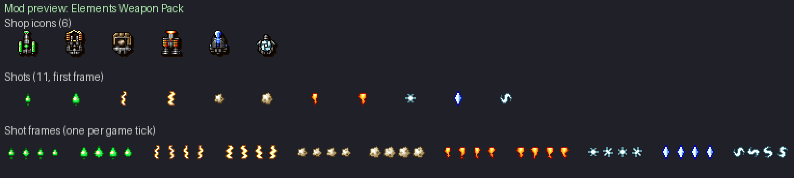

# Elements Weapon Pack

Six elemental weapons: **fire**, **ice** and **lightning** for the front bay,
**earth**, **acid** and **wind** for the rear bay, each with **eleven power
levels** like the original weapons (`front[]` / `rear[]`, MODDING.md §5.3).

Shop icons are 24x28 gun housings in the look of the original shop icons:
each one is built from the housing of an original icon (grey metal body, dark
rim, two-step drop shadow) and re-shaped and repainted for its element. Shots
are 12x14 sprites like the original ones (bright core, saturated colour, dark
rim of the same hue), four animation frames each, one look per element. Only
colours of the game palette are used. How they were made: section *Sprites*
below and `docs/mod-art-pipeline.md`.

Enable it in **Setup → Mods**. All six are sold in every shop.



| Weapon | Element | Bay | Role | Price | Power use | What it does |
|---|---|---|---|---|---|---|
| Flame Lance | fire | front | short range | 1000 | 45 | Fast fire jets that burn out after 12 to 16 ticks (`sub_delay`), 96 to 128 pixels ahead (about two thirds of the screen height): the highest damage of the front guns up close, nothing far away. 1 jet at level 1, 5 at level 11 (larger flames from level 6). |
| Frost Shard | ice | front | control | 1050 | 60 | Ice shards plus frost flakes with the `"freeze"` damage code: a flake deals no damage but freezes the enemy it hits, which stops firing for 40 ticks (ground enemies turn blue). 1 shard + 1 flake at level 1, 4 shards + 2 flakes from level 8. |
| Arc Caster | lightning | front | zig-zag | 1000 | 50 | Lightning bolts weaving left and right as they fly (`circle_radius` 23: 3 pixels of swing, 1 of bob), so a pair of bolts sweeps a wider column. From level 6 the middle bolt is a large piercing arc (`{"pierce": 3}`, then 4). 1 bolt at level 1, 5 at level 11. |
| Boulder Mortar | earth | rear | heavy | 1100 | 110 | Heavy boulders that sag back a few pixels, then pick up speed and hurtle forward (`speed_y` -2, `accel_y` 1): slow to leave the gun, very fast at the top of the screen. The highest damage per hit of the pack (6 to 12) and the highest energy use. 1 boulder at level 1, 4 at level 11. |
| Acid Rain | acid | rear | area | 950 | 50 | A fan of acid drops thrown upward that slow down and rain back down across the screen (`accel_y` -1). The drops eat through every enemy they cross (`{"pierce": 1}` or 2, large drops 2). 3 drops at level 1, 8 at level 11. |
| Gale Blades | wind | rear | flanks | 1000 | 55 | Spinning wind blades cutting sideways through every enemy in their row (`{"pierce": 2}` to 4), then also on the forward diagonals (level 5), the rear diagonals (level 7) and steeply forward (level 11). 2 blades at level 1, 8 at level 11. |

## Balance

Damage per second (DPS) = damage of one volley × 35 / (fire_delay + 1), the
game running at 35 ticks per second. A piercing shot is counted once (single
target); a spread counts every projectile (what a wide target takes); a freeze
flake counts 0. Energy per second = power use × 35 / (fire_delay + 1): the
power use is paid at every volley (wiki, *Weapons* and *Generators* pages).
The originals compared are the direct-fire guns sold at 900 to 1100 credits,
read from the game data (`data/tyrian.hdt`), the same set as the Alien Weapon
Pack. Tables generated by

```
python utils/mod_weapon_balance.py rewrite/mods/elements_weapon_pack/mod.json --median \
    --names "Lightning Cannon,Sonic Impulse,Hyper Pulse,HotDog Front,Zica Laser,Starburst,Scatter Wave,Sonic Wave,HotDog Rear,NortShip Spreader"
```

(add `--energy` for the energy tables).

### Damage per second

#### Front (DPS, single target)

| Weapon | Price | Power | L1 | L2 | L3 | L4 | L5 | L6 | L7 | L8 | L9 | L10 | L11 |
|---|---|---|---|---|---|---|---|---|---|---|---|---|---|
| Flame Lance | 1000 | 45 | 21.0 | 26.2 | 35.0 | 42.0 | 43.8 | 56.0 | 61.2 | 70.0 | 78.8 | 84.0 | 91.0 |
| Frost Shard | 1050 | 60 | 15.0 | 20.0 | 26.2 | 30.0 | 39.4 | 50.0 | 52.5 | 61.2 | 65.0 | 70.0 | 81.7 |
| Arc Caster | 1000 | 50 | 17.5 | 21.0 | 35.0 | 35.0 | 42.0 | 52.5 | 58.3 | 63.0 | 64.2 | 70.0 | 84.0 |
| *Lightning Cannon (original)* | 1000 | 70 | 17.5 | 23.3 | 40.8 | 52.5 | 46.7 | 70.0 | 58.3 | 81.7 | 81.7 | 70.0 | 140.0 |
| *Sonic Impulse (original)* | 1000 | 50 | 17.5 | 23.3 | 35.0 | 35.0 | 35.0 | 46.7 | 52.5 | 70.0 | 70.0 | 70.0 | 70.0 |
| *Hyper Pulse (original)* | 1050 | 50 | 11.7 | 17.5 | 23.3 | 26.2 | 35.0 | 46.7 | 43.8 | 52.5 | 56.0 | 63.0 | 78.8 |
| *Zica Laser (original)* | 1100 | 90 | 24.5 | 35.0 | 42.8 | 56.9 | 74.4 | 78.8 | 87.5 | 150.0 | 170.0 | 166.2 | 192.5 |
| *HotDog Front (original)* | 1100 | 40 | 17.5 | 23.3 | 28.0 | 35.0 | 42.0 | 52.5 | 56.0 | 58.3 | 70.0 | 70.0 | 80.0 |
| *median of the originals above* | | | 17.5 | 23.3 | 35.0 | 35.0 | 42.0 | 52.5 | 56.0 | 70.0 | 70.0 | 70.0 | 80.0 |

#### Rear (DPS, single target)

| Weapon | Price | Power | L1 | L2 | L3 | L4 | L5 | L6 | L7 | L8 | L9 | L10 | L11 |
|---|---|---|---|---|---|---|---|---|---|---|---|---|---|
| Boulder Mortar | 1100 | 110 | 20.0 | 24.2 | 32.1 | 35.0 | 46.7 | 53.8 | 70.0 | 75.4 | 81.7 | 86.2 | 93.3 |
| Acid Rain | 950 | 50 | 11.7 | 15.6 | 21.9 | 26.2 | 35.0 | 43.8 | 52.5 | 70.0 | 81.7 | 81.7 | 93.3 |
| Gale Blades | 1000 | 55 | 15.6 | 20.0 | 26.2 | 30.0 | 38.9 | 43.8 | 62.2 | 70.0 | 78.8 | 87.5 | 93.3 |
| *Starburst (original)* | 900 | 20 | 23.3 | 23.3 | 35.0 | 35.0 | 46.7 | 46.7 | 70.0 | 70.0 | 93.3 | 105.0 | 186.7 |
| *Scatter Wave (original)* | 900 | 40 | 14.0 | 21.0 | 23.3 | 23.3 | 35.0 | 40.8 | 52.5 | 64.2 | 70.0 | 70.0 | 81.7 |
| *Sonic Wave (original)* | 950 | 50 | 10.0 | 15.0 | 20.0 | 25.0 | 30.0 | 50.0 | 70.0 | 75.0 | 80.0 | 90.0 | 100.0 |
| *HotDog Rear (original)* | 1100 | 40 | 23.3 | 35.0 | 35.0 | 52.5 | 70.0 | 70.0 | 84.0 | 98.0 | 93.3 | 80.0 | 80.0 |
| *NortShip Spreader (original)* | 1100 | 40 | 17.5 | 26.2 | 35.0 | 52.5 | 70.0 | 70.0 | 87.5 | 105.0 | 157.5 | 17.5 | 26.2 |
| *median of the originals above* | | | 17.5 | 23.3 | 35.0 | 35.0 | 46.7 | 50.0 | 70.0 | 75.0 | 93.3 | 80.0 | 81.7 |

### Generator energy per second

#### Front (generator energy per second)

| Weapon | Price | Power | L1 | L2 | L3 | L4 | L5 | L6 | L7 | L8 | L9 | L10 | L11 |
|---|---|---|---|---|---|---|---|---|---|---|---|---|---|
| Flame Lance | 1000 | 45 | 315 | 394 | 394 | 315 | 394 | 315 | 394 | 315 | 394 | 315 | 315 |
| Frost Shard | 1050 | 60 | 300 | 300 | 262 | 300 | 262 | 300 | 262 | 262 | 300 | 300 | 350 |
| Arc Caster | 1000 | 50 | 292 | 350 | 292 | 292 | 350 | 292 | 292 | 350 | 292 | 292 | 350 |
| *Lightning Cannon (original)* | 1000 | 70 | 408 | 408 | 408 | 408 | 408 | 408 | 408 | 408 | 408 | 817 | 1225 |
| *Sonic Impulse (original)* | 1000 | 50 | 438 | 583 | 438 | 438 | 438 | 583 | 438 | 438 | 438 | 438 | 438 |
| *Hyper Pulse (original)* | 1050 | 50 | 583 | 438 | 583 | 438 | 583 | 583 | 438 | 438 | 350 | 350 | 438 |
| *Zica Laser (original)* | 1100 | 90 | 315 | 350 | 350 | 394 | 394 | 394 | 394 | 450 | 450 | 394 | 394 |
| *HotDog Front (original)* | 1100 | 40 | 350 | 467 | 280 | 350 | 280 | 350 | 280 | 233 | 233 | 200 | 200 |
| *median of the originals above* | | | 408 | 438 | 408 | 408 | 408 | 408 | 408 | 438 | 408 | 394 | 438 |

#### Rear (generator energy per second)

| Weapon | Price | Power | L1 | L2 | L3 | L4 | L5 | L6 | L7 | L8 | L9 | L10 | L11 |
|---|---|---|---|---|---|---|---|---|---|---|---|---|---|
| Boulder Mortar | 1100 | 110 | 275 | 296 | 321 | 275 | 321 | 296 | 296 | 296 | 321 | 296 | 321 |
| Acid Rain | 950 | 50 | 194 | 194 | 219 | 219 | 219 | 219 | 219 | 250 | 292 | 292 | 292 |
| Gale Blades | 1000 | 55 | 214 | 275 | 241 | 275 | 214 | 241 | 214 | 241 | 241 | 241 | 214 |
| *Starburst (original)* | 900 | 20 | 233 | 233 | 350 | 350 | 233 | 233 | 350 | 350 | 233 | 175 | 233 |
| *Scatter Wave (original)* | 900 | 40 | 280 | 280 | 233 | 233 | 233 | 233 | 233 | 233 | 233 | 233 | 233 |
| *Sonic Wave (original)* | 950 | 50 | 250 | 250 | 250 | 250 | 250 | 250 | 250 | 250 | 250 | 250 | 250 |
| *HotDog Rear (original)* | 1100 | 40 | 467 | 350 | 350 | 350 | 350 | 280 | 280 | 280 | 233 | 200 | 200 |
| *NortShip Spreader (original)* | 1100 | 40 | 350 | 350 | 350 | 350 | 350 | 350 | 350 | 350 | 350 | 350 | 350 |
| *median of the originals above* | | | 280 | 280 | 350 | 350 | 250 | 250 | 280 | 280 | 233 | 233 | 233 |

Reading the tables:

- At every level each weapon stays between the weakest and the strongest
  original of its price band.
- Flame Lance sits 0 to 20 % above the median: its jets vanish after half a
  screen, so it pays for the damage with its range. Boulder Mortar (heavy)
  stays within 15 % of the median and has the highest energy use of the pack.
  Arc Caster stays within 12 % of the median.
- Frost Shard stays 5 to 25 % under the median up to level 9 and at the
  median at levels 10 and 11: part of each volley is frost flakes that do no
  damage but stop the enemy's guns.
- Acid Rain and Gale Blades pierce (a piercing shot hurts again on every tick
  it overlaps an enemy, and hits every enemy on its path), so they stay 7 to
  38 % under the median up to level 9. At levels 10 and 11 the median of the
  rear originals drops (NortShip Spreader falls to 17.5 and 26.2); there the
  rear weapons end 2 to 14 % above it, still under the other originals of the
  band (Sonic Wave 90 / 100, Starburst 105 / 187).
- Energy per second is on the scale of the originals: front guns 262 to 394
  (originals of the table: 200 to 1225), rear guns 194 to 321 (originals: 175
  to 467). A Standard MR-9 generator (350 per second) feeds any one of them at
  level 1.

## Sprites

| File | Use |
|---|---|
| `sprites/pickups/weapons/*_icon.png` | 24x28 shop icons (`icon_sprite`) |
| `sprites/shots/<name>_1.png` .. `_4.png` | 12x14 shot frames: `flame_jet`, `flame_jet_large`, `frost_shard`, `frost_flake`, `arc_bolt`, `arc_bolt_large`, `boulder`, `boulder_large`, `acid_drop`, `acid_drop_large`, `gale_blade` |

The engine numbers the PNGs of `sprites/shots/` in name order, so the four
frames of a shot get consecutive sprite slots: each power level cites frame
`_1` and sets `"animation": 3`, which cycles the four frames, one per tick.
Keep that naming pattern when replacing a shot.

How they are made (both scripts are deterministic, no image generator):

```
python utils/elements_weapons_icons.py rewrite/mods/elements_weapon_pack/sprites/pickups/weapons
python utils/elements_weapons_shots.py rewrite/mods/elements_weapon_pack/sprites/shots
python utils/mod_art_clean.py check rewrite/mods/elements_weapon_pack/sprites
python utils/mod_preview.py rewrite/mods/elements_weapon_pack "Elements Weapon Pack"
```

| Icon | Original housing | Element parts |
|---|---|---|
| Flame Lance | Guided Bombs | flared nozzle with a white-hot mouth, three rows of glowing red-orange vents per side, hot core line |
| Frost Shard | Protron | tall pale-blue crystal barrel rising from the hood, the red core repainted as ice, frosted shoulder pods |
| Arc Caster | Pulse-Cannon | both barrels turned into copper coils (bright turns, dark windings), a yellow-white arc jumping between their tips, glowing capacitor |
| Boulder Mortar | Mega Cannon | rough stone blocks split by cracks instead of the red block, mortar bore holding a boulder, stone side plates |
| Acid Rain | Poison Bomb | two green acid tanks with a yellow highlight and bubbles instead of the side rails, green-yellow core, dripping shower head on the spire |
| Gale Blades | Multi-Cannon | teal turbine rotor with four curved blades and a white hub, teal sheen on the arm tips |

The shots come from shapes added at run time to `utils/mod_shot_draw.py`
(same cell, supersampling and dark rim): `flame` (fire gradient), `shard`
(deep blue to white), `flake` (pale cyan), `bolt` (copper rim, yellow-white
core), `boulder` (earth browns), `drop` (green to yellow), `gale` (teal to
white).
